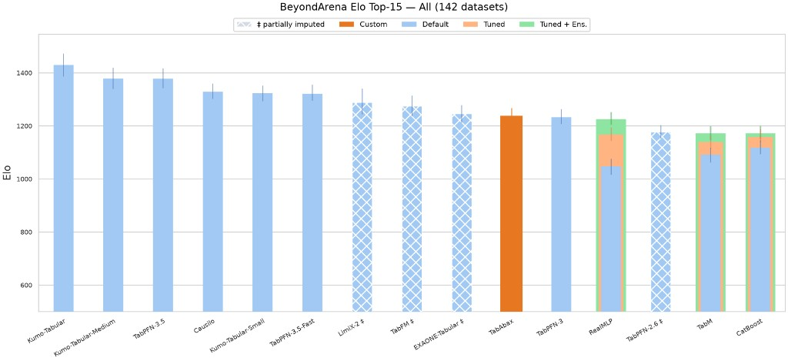

# TabAbax

Scikit-learn estimators for tabular classification and regression. `fit` stores the training table as context. Each ensemble member runs one forward pass of a pretrained model. The default estimator uses eight dataset-view ensemble members. The model weights are not updated.

This repository contains inference code and the benchmark entry points under `benchmark/`. It does not contain pre-training code, synthetic prior generation, training datasets, optimizer configuration, or checkpoint-generation scripts. The released checkpoints were trained from a TabICLv2-derived implementation with additional architectural and prior changes.

## Results

Each ensemble member performs one forward pass. The default estimator uses eight dataset-view ensemble members.



Ranked 10th of 41 methods on the 142 BeyondArena core datasets, with an Elo of 1237.7.

`benchmark/` documents and runs the evaluation procedure. Exact reproduction of the reported scores is not guaranteed; see `results/README.md` for the run artifacts and environment details that were not kept.

## Install

Python >= 3.10.

From a clone, install the inference dependencies and then the package:

```bash
pip install -r requirements.txt
pip install -e .
```

`requirements.txt` lists torch, scikit-learn, numpy, scipy, pandas, einops, psutil, tqdm, and huggingface-hub. The same list is in `pyproject.toml`, so this also works:

```bash
pip install -e .
```

From GitHub:

```bash
pip install "git+https://github.com/tababax-research/TabAbax.git"
```

## Weights

Leave `model_path` unset. The first `fit` downloads the public checkpoint from [tababax-ai/TabAbax](https://huggingface.co/tababax-ai/TabAbax) and stores it in the Hugging Face cache (`~/.cache/huggingface/hub`, or the directory in `HF_HOME`). Later runs reuse that file.

| Estimator | File |
| --- | --- |
| `TabAbaxClassifier` | `tababax-classifier.ckpt` |
| `TabAbaxRegressor` | `tababax-regressor.ckpt` |

The checkpoints on [tababax-ai/TabAbax](https://huggingface.co/tababax-ai/TabAbax) are separate artifacts under CC-BY-NC-4.0 and are not licensed for commercial use. The inference implementation contains TabICL v2 portions that remain BSD-3-Clause. See `NOTICE`. Set `allow_auto_download=False` to refuse a download. Pass `model_path` when the checkpoint is already on disk; an existing file is loaded and nothing is downloaded.

```python
TabAbaxClassifier(model_path="path/to/classifier.ckpt", allow_auto_download=False)
```

## Usage

The defaults are the recommended settings. No checkpoint path is required.

```python
from tababax import TabAbaxClassifier, TabAbaxRegressor

clf = TabAbaxClassifier()
clf.fit(X_train, y_train)
clf.predict(X_test)
clf.predict_proba(X_test)

reg = TabAbaxRegressor()
reg.fit(X_train, y_train)
reg.predict(X_test)
```

Inputs may be NumPy arrays or pandas DataFrames. String and categorical columns are encoded inside `fit`.

Recommended defaults:

| Parameter | Default | What it does |
| --- | --- | --- |
| `n_estimators` | `8` | Number of dataset views in the ensemble. `1` is a single forward pass. |
| `batch_size` | `1` | Ensemble members forwarded together. `None` sends every member in one batch. |
| `model_path` | `None` | Local checkpoint. Unset means download the file named by `checkpoint_version`. |
| `allow_auto_download` | `True` | Download that file when `model_path` is missing or does not exist. |
| `checkpoint_version` | classifier: `tababax-classifier.ckpt`; regressor: `tababax-regressor.ckpt` | File name on `tababax-ai/TabAbax`. |
| `device` | `None` | CUDA when it is available, otherwise XPU, MPS, then CPU. |
| `use_amp` | `"auto"` | Mixed precision from the table size. Stays off for small tables and on CPU. |
| `use_fa3` | `False` | FlashAttention-3. Leave this off unless the runtime provides it. |
| `offload_mode` | `"auto"` | Places the large column embedding in GPU, CPU, or disk memory according to what is free. |
| `random_state` | `42` | Ensemble shuffling. |

## AutoGluon and TabArena

The integration surface is the two estimators:

- `tababax.TabAbaxClassifier`: `fit`, `predict`, `predict_proba`
- `tababax.TabAbaxRegressor`: `fit`, `predict`

No extra server or training entry point is required. A caller constructs the estimator with the defaults above and uses the scikit-learn API. Pass `model_path` only when the checkpoint should come from a local file.

## Layout

```
src/tababax/_model/     architecture and in-context forward pass
src/tababax/_sklearn/   estimators, preprocessing, checkpoint loading
tests/test_import.py          public import check
```

`_model/learning.py` is the in-context forward path. It is not a pre-training loop.

## Benchmark

`benchmark/README.md` has the TabArena and BeyondArena commands. `main.py` runs the jobs and `evaluate.py` prints the leaderboard from the pickles that run writes. Those pickles, and the TabArena and BeyondArena revisions and machine versions used on 2026-10-26, were not kept, so a rerun reproduces the procedure rather than the exact numbers.

## Relationship to TabICL

TabAbax is a research derivative of the TabICLv2 inference implementation. It is not an independent implementation from scratch.

Our contributions include modifications to the model architecture, changes to the synthetic-data prior and training distribution, newly trained checkpoints, renamed public APIs, and inference and memory-management changes. The training code and prior-generation code are not in this repository. TabICL v2.2.0, commit `0dbff3ec8fc68c123c87af77b0ea8b25cd2d23f3`, is the version this repository was compared against; it is not a record of the commit that was originally copied. `PROVENANCE.md` lists which files match that version and which are modified.

These modules are derived from [TabICL](https://github.com/soda-inria/tabicl), Copyright (c) 2025, Soda team @ Inria, and remain BSD-3-Clause:

- `src/tababax/_model/`
- `src/tababax/_sklearn/base.py`
- `src/tababax/_sklearn/classifier.py`
- `src/tababax/_sklearn/regressor.py`
- `src/tababax/_sklearn/preprocessing.py`
- `src/tababax/_sklearn/sklearn_utils.py`
- `src/tababax/_torch_devices.py`

`preprocessing.py` also contains TabR (MIT) and PyTabKit (Apache-2.0) portions. `sklearn_utils.py` contains scikit-learn (BSD-3-Clause) portions. `src/tababax/_model/rope.py` contains rotary-embedding-torch (MIT) portions. See `NOTICE` and `PROVENANCE.md`.

## License

Code derived from TabICL is BSD-3-Clause. See `LICENSES/BSD-3-Clause.txt`.

TabR-derived and rotary-embedding-torch portions are MIT. See `LICENSES/MIT.txt`.

PyTabKit-derived portions and TabAbax packaging are Apache-2.0. See `LICENSES/Apache-2.0.txt`.

The root `LICENSE` file is an index of these licenses. It does not mean the whole repository is Apache-2.0.

The pretrained weights are CC-BY-NC-4.0 and are restricted to non-commercial use. The Hugging Face model card at https://huggingface.co/tababax-ai/TabAbax is kept in sync with `docs/huggingface_model_card.md` in this repository.
